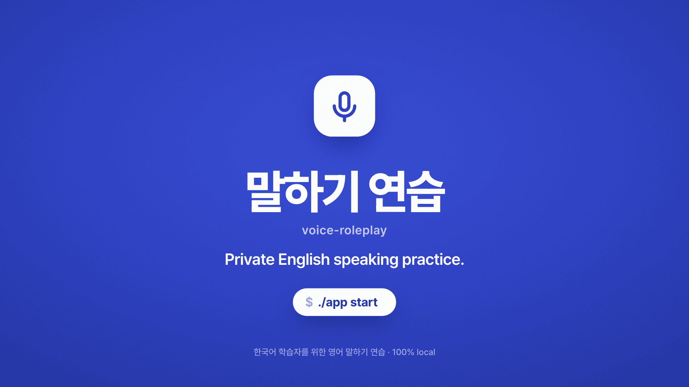
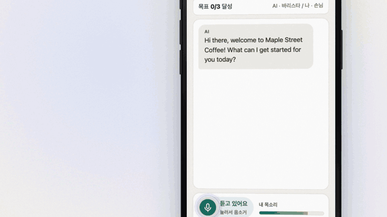
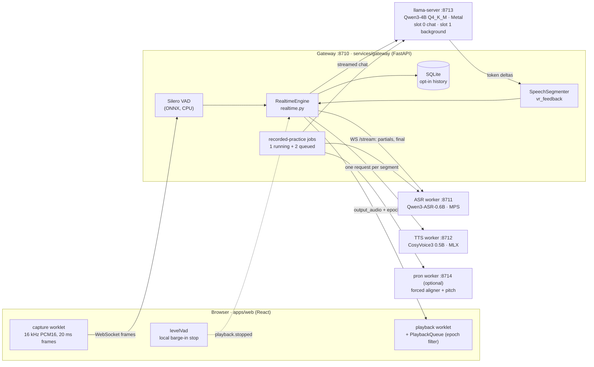

<p align="center">
  <a href="https://cskwork.github.io/voice-roleplay/">
    
  </a>
</p>

# voice-roleplay

**An English speaking partner for Korean learners that runs entirely on a Mac: streaming speech recognition, a local LLM and a local voice, with barge-in.**

[Website](https://cskwork.github.io/voice-roleplay/) · [30-second video](https://cskwork.github.io/voice-roleplay/media/voice-roleplay-launch-1080p.mp4) · [한국어 README](README.ko.md) · [Architecture](docs/architecture.md) · [Benchmark report](benchmarks/results/2026-09-29-m3pro.md)

<p align="center">
  
</p>

## Problem

Speaking out loud is the part of language practice most learners skip. A human partner can feel like too
much, and cloud practice apps send every word you say to a server. voice-roleplay gives Korean learners of
English a patient partner for everyday situations (cafe, directions, hotel check-in, job interview). Speech
recognition, the language model and the voice all run on the learner's own Mac, bound to `127.0.0.1`. After
`./app setup`, nothing needs the network.

The engineering problem is a full-duplex voice loop on a laptop. It needs live partial captions while you
speak, a reply that starts speaking before it is fully generated, and the ability to cut the AI off
mid-sentence without old audio leaking through. All of that has to fit three models into one machine's memory.

## Architecture



The browser talks only to the gateway, over HTTP and one WebSocket, with cookie, CSRF and Origin checks.
The gateway starts every worker with a fresh `X-Worker-Token` and an offline environment (`supervisor.py`).
One realtime turn goes Silero VAD → ASR stream → LLM stream → sentence segmenter → TTS stream → playback.
The full walkthrough is in [`docs/architecture.md`](docs/architecture.md): the turn sequence, barge-in,
the latency budget, model loading and failure handling. The wire contract is in
[`contracts/PROTOCOL.md`](contracts/PROTOCOL.md), and the Korean diagrams are in [`docs/architecture/`](docs/architecture/README.md).

## Key technical decisions

- **Barge-in is guarded by an epoch counter and one send lock.** Cancelling increments the session epoch
  under the lock that every send takes. Once `response.cancelled` goes out, no frame of the old reply can
  follow it. The browser stops playback by itself first and drops frames from older epochs. Only segments
  that actually played enter the history.
  `services/gateway/src/vr_gateway/realtime.py` (`_cancel_response`, `_send_locked`, `_fold`),
  `apps/web/src/lib/playbackQueue.ts`. [ADR 0002](docs/adr/0002-epoch-guarded-barge-in.md)
- **Speech starts before the reply is finished.** The segmenter emits a first clause of 4 or more words, then
  whole sentences. It never cuts before the next character arrives, so "$4." waits for "50". After the first
  "?", it closes the LLM stream. `workers/feedback/src/vr_feedback/segmenter.py`, `realtime.py` (`_produce`).
- **TTS runs on MLX, with PyTorch as the fallback.** The vendored PyTorch CosyVoice3 ran at stream RTF p95
  2.13. The MLX port with 5 flow steps and a 50-token first chunk measured 0.72 with no stalls in the engine
  benchmark. `workers/tts/tts_worker/backend.py`, `engine_mlx.py`. [ADR 0001](docs/adr/0001-mlx-tts-backend.md)
- **One llama-server, two fixed KV slots.** The conversation stays on slot 0, with its prompt pre-warmed at
  session start. Goals, summaries and feedback go to slot 1, so they never evict the conversation's prefix
  cache. `config/llm/server.json` (`-np 2 --no-kv-unified`), `services/gateway/src/vr_gateway/app.py`.
  [ADR 0003](docs/adr/0003-llama-server-two-slots.md)
- **Turn-taking adapts to hesitation.** Silero hysteresis (on at 0.5, off below 0.35) runs on 32 ms windows.
  The end-of-turn silence depends on difficulty (700 to 1200 ms) and gets 400 ms more, once, if the live
  caption ends in "um", "and" or "because". `realtime.py` (`_on_window`, `ends_with_filler`),
  `services/gateway/src/vr_gateway/vad.py`.

## Run locally

Requires an Apple Silicon Mac, uv, git, Node.js 22+, `brew install llama.cpp` and about 30 GB of disk.
Details: [`docs/setup.md`](docs/setup.md).

```sh
git clone https://github.com/cskwork/voice-roleplay.git
cd voice-roleplay
./app setup    # the only networked step: uv envs, web build, pinned models with SHA-256 checks (asks y/N)
./app doctor   # machine, runtimes, model hashes, ports, voices, offline readiness
./app start    # prints http://127.0.0.1:8710 once the workers are warm
./app stop
```

These launcher commands were not re-run for this README: setup downloads about 19 GiB of models. The tests
below were run.

## Testing

These tests need no model files. CI ([`.github/workflows/ci.yml`](.github/workflows/ci.yml)) runs them on
every pull request and every push to `main`:

```sh
cd services/gateway && uv sync --frozen && .venv/bin/python -m pytest -q -rs       # fake workers + real Silero VAD
cd workers/feedback && ../../services/gateway/.venv/bin/python -m pytest -q -rs
cd benchmarks/pronunciation && ../../services/gateway/.venv/bin/python -m pytest -q -rs tests
uv run --no-project --with jsonschema --with pytest python -m pytest -q tests/content
cd apps/web && npm ci && npm run build && npx vitest run                           # build = tsc --noEmit + vite build
```

Results on 2026-10-28:

| Suite | CI (ubuntu-latest) | Local (macOS, Apple M4) |
|---|---|---|
| Gateway | 120 passed, 0 failed, 6 skipped | 124 passed, 0 failed, 2 skipped |
| Feedback library | 50 passed, 0 failed, 9 skipped | 50 passed, 0 failed, 9 skipped |
| Pronunciation benchmark harness | 18 passed, 0 failed, 1 skipped | 18 passed, 0 failed, 1 skipped |
| Scenario content | 103 passed | 103 passed |
| Web (vitest) | 52 passed, 11 files | 52 passed, 11 files |

Fixed on this branch: on a clean `npm ci`, `npm run build` (step 3 of `./app setup`) failed with TS2339 in
`apps/web/vite.config.ts`. The dev-proxy typings need `@types/node`, which was not declared. Commit 0106928
adds it, and the CI web job now runs that exact build.

What the skips are:
- Gateway: 2 tests need `VR_INTEGRATION=1` and the real stack. On Linux, 4 more skip because the real-VAD
  test needs macOS `say` and ffmpeg.
- Feedback library: 9 tests need llama-server running.
- Benchmark harness: 1 test needs scipy.

The realtime tests wait at most 3 s for each event, which makes them timing-sensitive. Two earlier local runs
were on a machine with a load average above 20, and each had one timeout, in a different test each time
(`test_hint_and_settings`, `test_end_request_closes_socket_with_ended_code`). Both passed when rerun alone,
and the final run above passed in full.

**Not run here:**
- ASR, TTS and pronunciation worker tests. Each needs its own torch environment, and the `model`-marked tests
  also need the weights: 86 test functions in `workers/*/tests`.
- `tests/integration/stack_smoke.py`.
- The Playwright suite (10 spec files, 19 tests). It runs against the real stack with a synthetic
  microphone. Commit d7ebf86 recorded all 16 tests that existed at the time passing. The 3 tests added
  later in `switch_realtime_recorded.spec.ts` have no recorded run.

## Measured performance

The benchmark ran 200 realtime turns on an Apple M3 Pro with 36 GB (2026-09-28), including 66 barge-ins.
The learner's voice was macOS `say` fed through the real capture path, so these are best-case numbers. Full
report: [`benchmarks/results/2026-09-29-m3pro.md`](benchmarks/results/2026-09-29-m3pro.md).

| Metric | Target | Measured | |
|---|---|---|---|
| Reply starts (last voiced sample → AI audio plays), p50 | ≤ 2.0 s | 3.26 s | missed |
| Reply starts, p95 | ≤ 4.0 s | 4.43 s | missed |
| TTS real-time factor per reply, p95 | ≤ 0.80 | 0.87 | missed |
| First live caption, p95 | ≤ 3.0 s | 0.66 s | met |
| Barge-in stops the AI, p95 | ≤ 0.35 s | 0.20 s | met |
| Recorded 30 s answer, full result, p95 | ≤ 25 s | 20.3 s | met |
| Recorded 120 s answer, full result, p95 | ≤ 60 s | 52.5 s | met |

Most of the 3.26 s reply start comes from three pieces: the 900 ms end-of-turn silence, the final ASR decode,
and the TTS first chunk (p50 1.17 s). With every model loaded, the five processes used about 22.7 GB of memory.

## Limitations and next steps

- This is a development build, validated on one machine (M3 Pro, 36 GB). It has not passed the project's own
  release criteria. The Linux + NVIDIA path (vLLM ASR) exists in code but has never been run.
- Replies start 3.26 s (p50) after you stop talking, against a 2 s target. TTS fell behind playback in 50 of
  134 uninterrupted replies.
- There is no pronunciation score. Experimental word bands sit behind `VR_PRON_EXPERIMENTAL=1` and are
  calibrated on Mandarin-L1 speakers only ([`docs/pronunciation.md`](docs/pronunciation.md)).
- Scenario sentences and Korean translations are drafts that need native-speaker review. The level-1 Korean
  hint is generated by the local LLM and can be wrong.
- Not measured yet: stop-button latency, 60-minute stability, memory over 10 sessions, and word error rate
  on real learner speech.
- Speakers can echo into the mic and trigger barge-in. An echo check turns auto barge-in off after 2
  suspected echoes, but a headset is still recommended.

More: [features and screenshots](docs/features.md) (with the roadmap), [privacy](docs/privacy.md),
[setup and per-component tests](docs/setup.md), [PRD](docs/PRD.md) (Korean), [triage](docs/TRIAGE.md) (Korean).

## Contributing

Issues and pull requests are welcome. The most useful help right now:

- Native English speakers reviewing the scenarios in [`content/scenarios/`](content/scenarios/), and Korean
  speakers reviewing the translations.
- Running `./app setup && ./app start` on other hardware and reporting what happened, especially Macs with
  less than 36 GB and Linux machines with NVIDIA GPUs.
- Latency work on the realtime path. The benchmark harness is `benchmarks/run.sh`.

## Credits and licence

Code and content: [Apache License 2.0](LICENSE). Third-party material is listed in [`NOTICE`](NOTICE).
Model weights are not included: `./app setup` downloads them from their publishers, and each keeps its own
licence.

The models are Qwen3-ASR-0.6B, Qwen3-4B-Instruct-2507 (GGUF by unsloth, served by llama.cpp),
Fun-CosyVoice3-0.5B-2512 (MLX conversion by mlx-community) and Silero VAD. The two AI voices are prompts
from LibriTTS-R speakers 4992 and 1188 (CC BY 4.0). Full attributions and licences:
[`docs/credits.md`](docs/credits.md).

## 한국어 요약

말하기 연습(voice-roleplay)은 한국어 화자가 카페 주문, 길 묻기, 호텔 체크인, 면접 같은 상황에서 AI와 영어로
소리 내어 대화하는 연습 앱입니다. 음성 인식(Qwen3-ASR), 언어 모델(Qwen3-4B, llama.cpp), 음성 합성(CosyVoice3, MLX)이
모두 Mac 안에서 돌고, 설치 후에는 인터넷 없이 동작하며 목소리가 기기 밖으로 나가지 않습니다. 말하는 동안 자막이
자라고, 답변은 문장 단위로 먼저 말하기 시작하며, AI가 말하는 중에 끼어들면 멈추고 듣습니다. 자세한 내용은
[한국어 README](README.ko.md)를 보세요.
