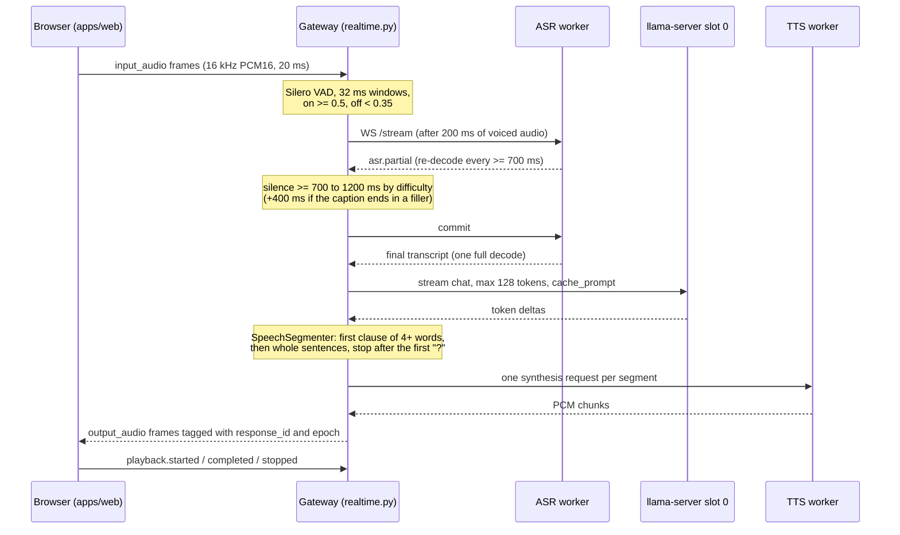

# Architecture

voice-roleplay is five local processes on one Mac. The browser talks only to the gateway. The gateway runs
turn-taking and orchestrates three model workers over loopback HTTP and WebSocket. Everything binds to
`127.0.0.1`. The Korean diagrams (system, one realtime turn, session state) are in
[`docs/architecture/`](architecture/README.md), and the wire contract is [`contracts/PROTOCOL.md`](../contracts/PROTOCOL.md).

## Components

| Process | Port | Code | What it does |
|---|---|---|---|
| Browser app | (served by the gateway) | `apps/web` (React 19, Vite, TypeScript) | Captures the microphone in an AudioWorklet, resamples to 16 kHz PCM16 and sends 20 ms frames. Plays reply audio through a second AudioWorklet. Its energy detector stops playback locally the moment the learner starts talking. |
| Gateway | 8710 | `services/gateway/src/vr_gateway` (FastAPI, uvicorn) | Auth, sessions, Silero VAD, the realtime engine, the recorded-practice job queue, optional SQLite history. It also starts and stops the workers. |
| ASR worker | 8711 | `workers/asr/asr_worker` | Qwen3-ASR-0.6B through `qwen-asr` (transformers) on MPS in bfloat16. `WS /stream` gives partial captions and one final transcript. `POST /transcribe` handles recorded answers. |
| TTS worker | 8712 | `workers/tts/tts_worker` | Fun-CosyVoice3-0.5B-2512. The MLX backend is the default on Apple Silicon (`engine_mlx.py`), and the vendored PyTorch code is the fallback (`engine.py`). Audio streams over a WebSocket. |
| LLM | 8713 | `llama-server` from Homebrew, flags in `config/llm/server.json` | Qwen3-4B-Instruct-2507 Q4_K_M with all layers on Metal. It runs two slots of 4096 tokens each: slot 0 is the conversation, slot 1 is background work. |
| Pronunciation worker (optional) | 8714 | `workers/pronunciation/pron_worker` | Qwen3-ForcedAligner-0.6B word timings and pyworld pitch, used for recorded practice only. |

Shared text logic lives in the `vr_feedback` library (`workers/feedback/src/vr_feedback`): it splits the
reply into sentences for speech, builds prompts, runs the streaming LLM client, and handles hints, goals,
summaries and feedback. The gateway imports it directly; it is not a separate process.

## Realtime turn: data flow

1. **Capture.** `apps/web/src/audio/worklets/capture.worklet.ts` downmixes and resamples. Each frame is a
   binary envelope: a u32 header length, a JSON header, then PCM. The format is in `protocol.py` and
   `apps/web/src/lib/envelope.ts`. The gateway rejects frames with the wrong session, rate, size or count.
2. **Turn-taking.** `RealtimeEngine._on_window` in `services/gateway/src/vr_gateway/realtime.py` applies
   hysteresis to the Silero probability (`vad.py`, ONNX on CPU, one shared session with per-stream state).
   It keeps 200 ms of pre-roll, opens the ASR stream after 200 ms of voiced audio (`ANNOUNCE_MS`), and drops
   utterances under 250 ms without calling the LLM. It warns at 40 s and cuts off at 45 s. A turn ends after
   `silence_ms` of quiet: easy 1200, normal 900, hard 700, clamped to 700–1400 (`sessions.py`). If the latest
   partial ends in "um", "and", "because" and similar words, it waits 400 ms longer, once.
3. **ASR.** The worker cannot stream natively on macOS, so `asr_worker/stream.py` re-decodes the buffered
   audio. A new partial starts only when at least 700 ms have passed since the last one, at least 300 ms of
   new audio has arrived, that audio is not silent, and no other decode is running or waiting. After 12 s,
   older audio is frozen at its quietest point. The final transcript is one full decode, and it jumps ahead
   of waiting partials.
4. **LLM.** `_produce` streams from llama-server slot 0 with at most 128 tokens. The scenario prompt is
   pre-warmed into that slot when the session starts (`_warm_llm`). Goal checks, rolling summaries and
   feedback use slot 1 (`app.py`: `LlmClient(..., default_slot=1)`), so they never evict the cached
   conversation prefix.
5. **Segmentation and TTS.** `vr_feedback/segmenter.py` emits a first clause as soon as it has 4 or more words
   and ends in `,` `;` or a dash. After that it emits whole sentences, never cutting before the next
   character arrives (so "$4." waits for "50"). Once a segment ends in "?", `_produce` closes the LLM stream:
   one question per reply. `_speak` sends each segment to TTS and forwards audio in 100 ms frames.
6. **Playback and history.** The browser reports `playback.started/completed/stopped` for each segment. Only
   segments that actually played, or were shown as text after a TTS failure, are folded into history
   (`_fold`). Hints, goals and summaries therefore see what the learner heard.

## Barge-in and cancellation

- **The browser goes first.** `apps/web/src/lib/levelVad.ts` is an energy detector with a noise floor. It
  needs 8 voiced frames (160 ms), then stops playback locally and sends `playback.stopped`.
- **Then the gateway.** When VAD announces speech while a reply is still playing, `_cancel_response`
  increments the session `epoch`, sends `response.cancelled`, sets the cancel event (which closes the
  llama-server stream) and cancels the TTS request. All of this happens under the same lock that every send
  takes (`_send_locked`, `_send_audio`). After `response.cancelled`, no text or audio frame of the old reply
  can go out.
- **Stale audio is dropped on both sides.** The server refuses to send frames whose epoch is older than the
  session's. The browser's `PlaybackQueue` (`apps/web/src/lib/playbackQueue.ts`) drops anything from an older
  epoch or a cancelled response.
- **Echo guard.** If the transcript of a barge-in overlaps the line that was playing by 60% or more, it is
  treated as speaker echo (`ECHO_OVERLAP`). After 2 such events, automatic barge-in is turned off for the
  session and the browser is told.
- A turn that started within 2 s of the browser stopping playback still counts as a barge-in
  (`CLIENT_STOP_WINDOW_S`), even when the reply had already finished generating.

## Latency budget (measured)

The figures come from 200 turns on an Apple M3 Pro, 36 GB, at normal difficulty (900 ms end-of-turn silence)
([`benchmarks/results/2026-09-29-m3pro.md`](../benchmarks/results/2026-09-29-m3pro.md)):

| Step | p50 | p95 |
|---|---|---|
| Last voiced sample → final transcript (includes the 900 ms silence) | 1,348 ms | 1,454 ms |
| `response.started` → first audio frame (LLM to first segment + TTS first chunk) | 1,932 ms | 3,030 ms |
| TTS first chunk, per request | 1,169 ms | 1,577 ms |
| First audio frame → played by the worklet | 6 ms | 11 ms |
| **Last voiced sample → AI audio plays** (target p50 2.0 s, p95 4.0 s) | **3,260 ms** | **4,430 ms** |
| Speech start → first partial caption | 491 ms | 664 ms |
| Speech start → AI audio stops on barge-in (n = 66) | 188 ms | 196 ms |

The end-of-turn silence and the TTS first chunk dominate. In 50 of 134 uninterrupted replies, TTS fell
behind playback for more than 50 ms.

## Model loading

- `./app setup` (`app`, `scripts/app_tool.py download`) is the only step that uses the network. It downloads
  just the files listed in [`models.lock.json`](../models.lock.json), at pinned revisions, and checks each
  SHA-256. The vendored CosyVoice is pinned to a commit in `workers/tts/setup.sh`.
- `python -m vr_gateway --manage-workers` (`supervisor.py`) starts each worker in its own process group
  with a fresh `X-Worker-Token` (`secrets.token_urlsafe(32)`), `HF_HUB_OFFLINE=1` and
  `TRANSFORMERS_OFFLINE=1`. It writes pid files to `var/run/` and polls each `/health` until it reports
  ready. If any worker fails to start, it stops all of them, so the stack never runs half-up. The
  pronunciation worker is skipped when its environment is not installed.
- Each worker opens its port first and loads the model in the background. `/health` reports `ready: false`,
  and requests get `503 MODEL_NOT_READY`, until the model has loaded and warmed up. A load failure exits the
  worker (ASR exit code 3). Bad configuration exits with code 2.
- The TTS backend is chosen in `tts_worker/backend.py`. `auto` picks MLX when running on Apple Silicon,
  `mlx` is importable and the MLX weights are present. Otherwise it picks PyTorch.

## Failure handling

| Failure | Behaviour | Code |
|---|---|---|
| ASR stream dies mid-utterance or at commit | Turn discarded, recoverable `ASR_FAILED`, back to LISTENING | `realtime.py` `_asr_pipeline` |
| LLM error or empty reply | Recoverable `LLM_FAILED`, and the learner's line stays last in history so `response.retry` works | `_run_response`, `h_response_retry` |
| TTS error or 60 s timeout on a segment | That segment becomes `text_only` (shown, not spoken), with one `TTS_FAILED` per reply | `_speak` |
| WebSocket send fails | Engine marks itself closed and stops sending. The session keeps its slot for a reconnect grace period | `_send_locked`, `sessions.py` |
| Recorded-practice queue full (1 running + 2 waiting) | `QUEUE_FULL`. Repeated idempotency keys return the existing job | `jobs.py` |
| Pronunciation worker missing or failing | Recorded result still returned; pronunciation marked unavailable | `pronunciation.py` |
| A worker fails to start | Everything is stopped; `./app start` refuses to run without model files | `supervisor.py`, `app` |

## Privacy boundaries

Every port is loopback-only. Browser requests need the `vr_sid` cookie, a CSRF header on mutations and an
allowlisted Host/Origin (`auth.py`). Workers need the per-start token, and llama-server gets it as its API
key because it answers CORS for any origin. Microphone audio is never written to disk. Recorded-practice
audio lives in memory until its job ends. Transcripts reach SQLite (`var/data/app.sqlite3`) only when the
learner opts in to history. Logs hold event names, ids and durations, never text or audio. Details:
[`docs/privacy.md`](privacy.md).

## External dependencies

Python 3.12 (gateway, ASR, pronunciation) and 3.10 (TTS), managed by uv with frozen lockfiles. Node.js 22
for the web build. `llama-server` from Homebrew (`config/llm/server.json` records the build it was verified
with). Models and licences are listed in [`docs/credits.md`](credits.md) and pinned in `models.lock.json`.
