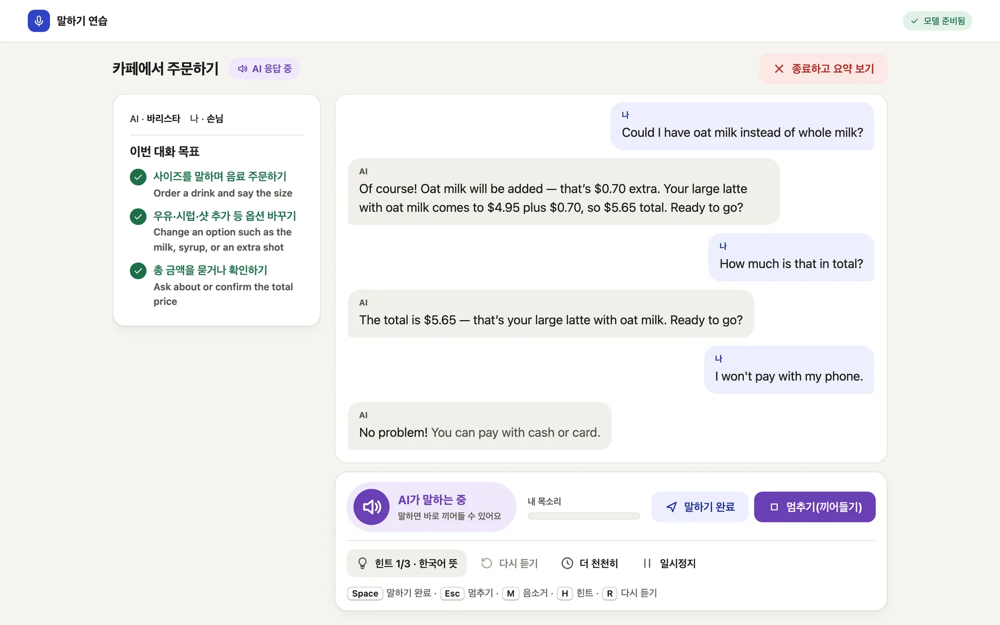
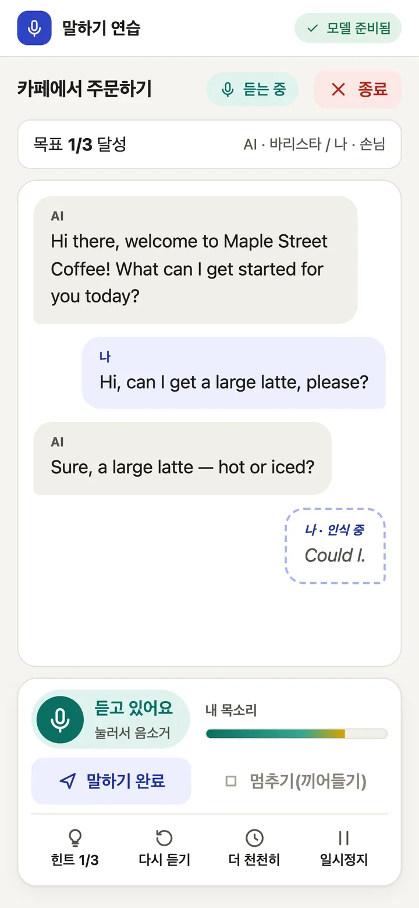
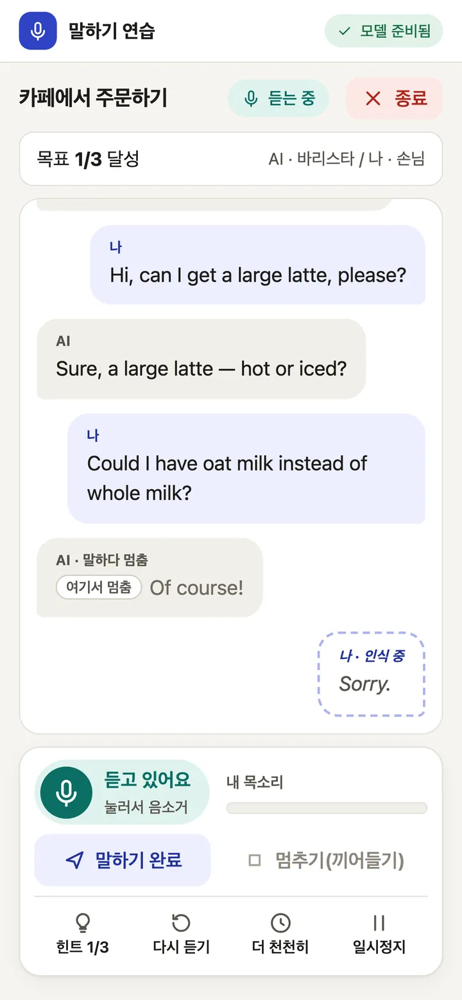
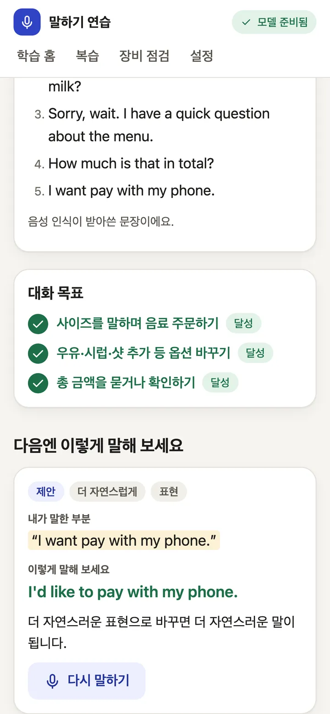
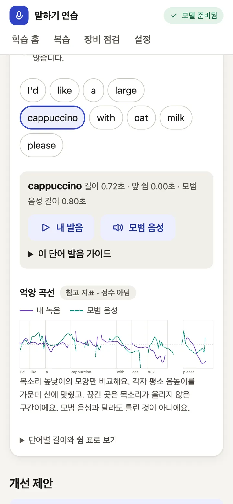

# Features

The app's interface is in Korean because it is built for Korean learners. The conversation is in English.
Every screenshot below is real app output; for the captures, the learner's lines were spoken by macOS `say`.

  

## Realtime roleplay

- **Live captions.** Your words appear while you speak and settle into the final transcript when you pause.
- **A natural voice.** Replies stream sentence by sentence through CosyVoice3, so the AI starts talking before the whole answer exists.
- **Barge-in.** Start talking while the AI speaks and it stops, marks where it stopped and listens. Only the words it actually said stay in the history.
- **Hint ladder.** Stuck? Take one step at a time: the Korean meaning of the AI's last line, then key words, then a full example sentence.
- **Goals and a session summary.** Each scenario has goals that tick off as you reach them. Afterwards you see what you said and a more natural way to say a line, with a "say it again" drill.

## Recorded practice

- Read a sentence, shadow the model voice, answer freely, or roleplay turn by turn. You get a transcript and written feedback on grammar and phrasing.
- With the optional word-timing worker: tap any word to hear your take next to the model voice, and compare pitch contours. This is a reference for your ear. There is **no pronunciation score**.

| Live captions | Barge-in | Summary and "say it again" | My take vs model voice |
|---|---|---|---|
|  |  |  |  |

Four scenarios so far: ordering at a cafe, asking for directions, hotel check-in and a job interview. Their sentences and translations are drafts that still need native-speaker review ([`content/README.md`](../content/README.md)).

## Roadmap

From [`docs/TRIAGE.md`](TRIAGE.md) (Korean):

- [ ] A consented Korean-learner speech set (target: 20+ speakers, 400 utterances) with human ratings from at least two raters, to validate pronunciation feedback before any score or band is shown
- [ ] Faster reply start (currently p50 3.26 s against a 2 s target) and fewer TTS stalls in long replies
- [ ] Native-speaker and translator review of every scenario, translation and model expression
- [ ] Short articulation guides for sounds Korean speakers often find hard (r/l, f/p, v/b, th), after review
- [ ] A test run on Linux with an NVIDIA GPU
- [ ] Real microphone and speaker device smoke tests
