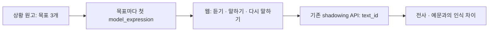

# 짧은 말하기 원고와 서버 연결 (2026-11-11)

상황마다 목표 순서대로 표현 3개를 연습한다. 학교·친구·일상 원고 4개를 더해 총 8개이며, 기존 자유 대화·녹음 연습도 같은 원고를 사용한다.



## 원고 계약

- 정본은 `content/scenarios/*.json`, 형식은 기존 `contracts/scenario.schema.json`이다. 스키마를 확장하지 않았다.
- 새 원고는 `friend_intro`, `snack_choice`, `weekend_plan`, `lost_and_found`이다. 각 원고는 목표 3개, 힌트 4개, 예문 6개, 읽기 4개, 따라 말하기 3개, 자유 답변 2개를 갖는다. 학교·이름·약속은 가상 상황이며 실제 연락처를 묻지 않는다.
- 기존 4개 원고의 ID·모든 text_id·상황 사실은 보존했다. 배경 설명과 긴 첫 표현을 줄였고, 카페의 첫 음료는 뒤의 우유 변경과 자연스럽게 이어지는 라테로 바꿨다. 변경한 원고의 버전을 한 단계 올렸다. TTS 캐시는 text_id뿐 아니라 글의 hash도 사용하므로 수정 전 소리를 재사용하지 않는다.
- 첫 표현은 목표마다 `model_expressions.find(e => e.goal_id === goal.goal_id)`로 고른다. 선택한 24개는 모두 3~11단어다. 길이는 `split()` 기준이며 영어 실력 점수가 아니다.
- 예문을 따라 말한 것은 자유 대화 목표 달성을 뜻하지 않는다. 인식 결과와 예문의 차이만 안내하며 의미·문법·발음 성공으로 판정하지 않는다.
- 이번 변경에서 문맥·번역 대응·스키마를 검토했다. `content/README.md`의 **영어 원어민·한국어 번역 검수 pending** 상태를 완료로 바꾸지 않았다. 사람의 언어 검수가 끝났다는 표시는 하지 않는다.

## 첫 표현 3개: 목표 순서

| 상황 | 선택 text_id 순서 | 선택한 영어 표현 순서 |
|---|---|---|
| `cafe_order` | `cafe_order_expr_01` → `03` → `06` | Could I get a small latte, please? / Can I get that with oat milk instead? / How much is that altogether? |
| `directions` | `directions_expr_01` → `04` → `06` | How do I get to the Riverside Public Library? / Two blocks north, then left on Oak Street, right? / Sorry, could you say that one more time? |
| `hotel_checkin` | `hotel_checkin_expr_01` → `04` → `07` | I have a reservation under Minjun Kim. / Could I have a room away from the elevator? / Is breakfast included in my rate? |
| `job_interview` | `job_interview_expr_01` → `03` → `06` | I'm a marketing intern, and I'd love to promote hiking gear. / I managed our Instagram account and posted three times a week. / My biggest strength is staying organized under pressure. |
| `friend_intro` | `friend_intro_expr_01` → `03` → `05` | Hi, I'm Minji. Nice to meet you! / I like drawing. / What do you like doing? |
| `snack_choice` | `snack_choice_expr_01` → `03` → `05` | I'd like an apple. / I like crunchy snacks. / Would you like an apple, too? |
| `weekend_plan` | `weekend_plan_expr_01` → `03` → `05` | Let's play badminton on Saturday. / How about two in the afternoon? / Let's meet at the school gate. |
| `lost_and_found` | `lost_and_found_expr_01` → `03` → `05` | I lost my pencil case. / It's blue with white stars. / Where can I pick it up? |

카페는 음료 → 옵션 → 가격, 길 묻기는 목적지 → 길 확인 → 되묻기, 호텔은 예약 → 객실 요청 → 시설 질문, 면접은 소개·관심 → 구체적 경험 → 강점 답변이다. 새 원고는 인사 → 관심 → 친구에게 질문, 간식 선택 → 이유 → 권하기, 활동 → 시간 → 장소, 잃은 물건 → 생김새 → 받을 곳 순서다. 긴 자유 대화의 전체 목표를 한 문장만으로 충족했다고 간주하지 않는다.

## 하위 호환 capability

기존 `GET /api/scenarios` 응답에 다음 형제 필드만 추가한다. 새 API endpoint는 없다. `scenarios` 배열과 상세 조회 주소는 그대로다.

```json
{
  "scenarios": [],
  "capabilities": { "guided_lessons": true }
}
```

위 예시는 빈 목록일 때의 응답이며, 실제 원고 8개가 정상 로드되면 `scenarios`에 그 객체 8개가 들어간다. Forge는 `guided_lessons === true`일 때만 새 `#/lesson/<id>/<difficulty>:0` 웹 주소를 연다. 필드 없음·false·잘못된 값은 미지원이다. 구형 소비자는 추가 필드를 무시하고 원래 배열을 계속 읽는다.

**게이트웨이의 true는 새 웹 화면도 함께 제공한다는 약속이다.** 게이트웨이 코드와 voice-roleplay 웹 빌드, Forge 클라이언트를 한 변경으로 배포해야 한다. 게이트웨이만 먼저 올리고 이전 웹 빌드를 제공하면 lesson 주소를 약속할 수 없다. 이 문서는 배포 완료의 증거가 아니다.

## 검증과 한계

- `tests/content/test_scenarios.py`: 기존 검사 기준을 유지하고 예상 ID·voice 목록만 8개로 확장한다. 스키마·원고 수·전역 ID 유일성·목표 참조·한국어/영어·길이·가격·voice 파일을 검사한다.
- `services/gateway/tests/test_speaking_content.py`: 8개 전체의 목표별 첫 표현·길이·TTS 참조를 검사하고, 기존 shadowing API로 24개 모두 생성되며 정확한 target과 저장 안 함을 유지하는지 확인한다.
- `services/gateway/tests/test_http.py`: 기존 목록 응답과 새 capability를 함께 확인한다.
- fake worker로 실행하는 gateway 검증은 실제 제공자 음질·지연·발음·학생 학습 효과를 증명하지 않는다. 실제 음성 품질과 사람의 언어 검수는 별도 증거가 필요하다.

공유 모드의 대화·복습 무저장, 발음 점수 없음, 제공자·Host·Origin·CSRF·키 정책은 변경하지 않는다. 새 표현을 위해 음성 파일이나 모델을 추가하지 않았다.
